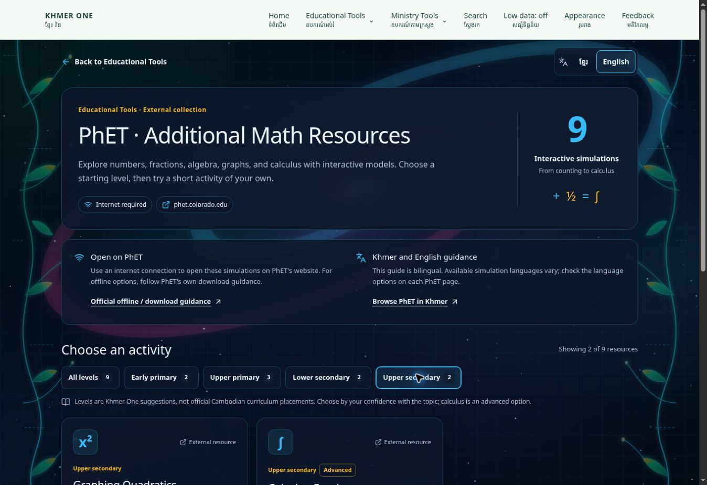

# PhET additional mathematics resources

The `/phet-math` page is a bilingual Khmer One guide to nine external PhET
activities. It is discoverable from the Educational Tools navigation, the app
catalog, search, and the Simulations filter. It does not host or modify PhET
simulation code.

## Suggested progression

- Early primary: Number Play; Make a Ten.
- Upper primary: Arithmetic; Fractions: Intro; Fraction Matcher.
- Lower secondary: Equality Explorer; Graphing Lines.
- Upper secondary: Graphing Quadratics; Calculus Grapher (advanced option).

These are Khmer One suggestions based on topic prerequisites, not official PhET
grade assignments or a claimed mapping to Cambodia's curriculum. Learners can
choose any level. Calculus should follow preparation in functions and graphs.

## Links, languages, and connectivity

Each activity opens its official `https://phet.colorado.edu/en/simulations/…`
landing page in a new tab. The Khmer One guide and learning prompts are bilingual;
the available languages inside each simulation must be checked on PhET. No
activity is marked as having a verified Khmer interface merely because its
directory card is translated.

The catalog entry has `offlineReady: false`. Internet is required to open these
external links. The page links to PhET's official offline-access guidance for
teachers who want to prepare supported downloads independently. The portal's
service worker is unchanged and does not cache third-party simulations.

## Source and maintenance

- Activities: <https://phet.colorado.edu/en/simulations/browse>
- Khmer listings: <https://phet.colorado.edu/en/simulations/filter?locale=km&type=html>
- Offline guidance: <https://phet.colorado.edu/en/offline-access>
- Licensing: <https://phet.colorado.edu/en/licensing>

PhET is developed by the University of Colorado Boulder. Current regular HTML
simulation files are offered under CC BY-NC 4.0, subject to PhET's terms. This
page links to official resources; it does not redistribute those files. The
old public simulation repositories state that they are no longer maintained.
Use the official simulation pages as the source of current language, download,
and licensing information.

The resource catalog lives in `data/phetMath.ts`; page text is in
`locales/phetMath.ts`; the app-directory entry is in `data/phet-app.ts`.
Review new titles, learning prompts, destination URLs, and suggested levels
together before adding another activity. Keep the original English activity
title visible so learners can recognize it on PhET.

## Verification

- Production build, TypeScript, focused ESLint, and whitespace checks passed.
- Homepage and site search return the collection for `Number Play`, `Make a Ten`,
  and `លេងជាមួយចំនួន`.
- Browser checks confirmed the Educational Tools entry, the Simulations filter,
  all nine initial cards, primary and upper-secondary filtering, and the Khmer /
  English guide toggle. Calculus carries the Advanced badge.
- Responsive CSS was reviewed; a separate mobile-device browser check remains
  unverified. Khmer copy has not been reviewed by a teacher.

Publication requires the existing Cloudflare deployment connection. These
checks and the screenshot describe the prepared update, not a live deployment.
